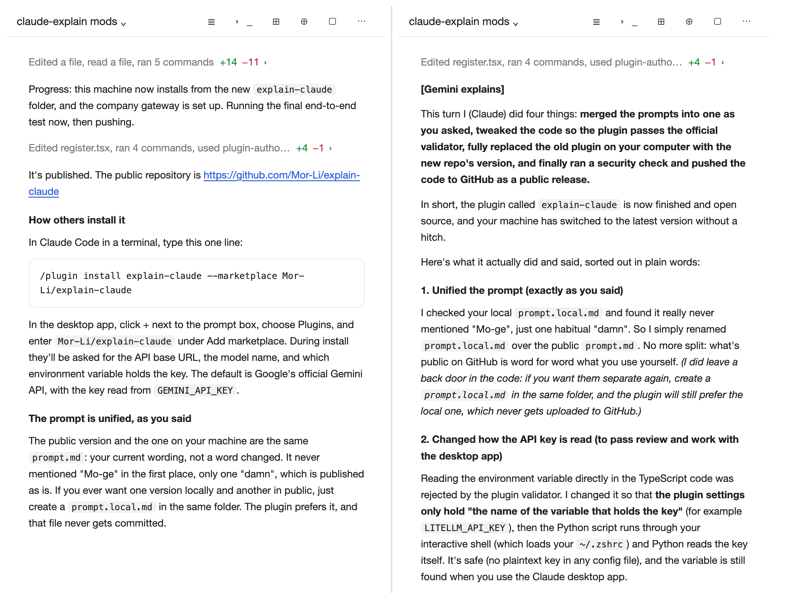

# explain-claude

English | [中文](README.zh-CN.md)

After a long turn, Claude Code's report is often long and hard to follow. This plugin hands the turn's full trajectory to Gemini (or any model behind an OpenAI-compatible API), asks it to retell what happened in plain language, and **replaces Claude's final reply on screen, in place**.



*Left: Claude's original reply. Right: the same spot about twenty seconds later, replaced by the Gemini retelling. This is a real session translated into English; the original Chinese screenshot is in the [Chinese README](README.zh-CN.md). The default prompt is in Chinese, so the retelling is too. Write your own prompt to get another language.*

## How it works

1. When a turn ends, the plugin checks two things: Claude **called tools at least 6 times**, and Claude's **final reply is over 400 characters** (whitespace not counted). Chit-chat turns rarely call tools, so they are skipped.
2. It reads the session's transcript file and takes the latest turn: the user's message, every tool call Claude made, what each tool returned, and Claude's final reply. That text goes after the prompt and is sent to the model.
3. When the model answers, the reply on screen is replaced by the retelling, headed **【Gemini 解读】**. This usually takes twenty to thirty seconds.

Only the display changes. The saved transcript and the context Claude itself reads stay as they were. Type `/gemini` to switch between the retelling and the original.

Until the model answers, Claude's original reply stays on screen. If the call fails (timeout, rate limit, wrong key), you get a short "Gemini 解读失败" notice and the original stays. The conversation goes on as usual.

## Install

In a Claude Code session in a terminal:

```
/plugin install explain-claude --marketplace Mor-Li/explain-claude
```

Or from a shell:

```bash
claude plugin install explain-claude --marketplace Mor-Li/explain-claude
```

In the Claude desktop app: click + next to the prompt box, choose Plugins, Add marketplace with `Mor-Li/explain-claude`, then Add plugin.

The installer asks whether to add the marketplace. Answer `y`, pick a scope, then fill in the settings below.

## Settings

| Setting | Default | What it is |
| --- | --- | --- |
| `base_url` | `https://generativelanguage.googleapis.com/v1beta/openai` | An OpenAI-compatible API base, without `/chat/completions`. The default is Google's Gemini API |
| `model` | `gemini-4-argon` | Any model your API serves |
| `api_key_env` | `GEMINI_API_KEY` | The **name** of the environment variable holding your key, not the key itself |
| `min_chars` | `400` | Skip turns whose final reply is shorter than this |
| `min_tool_calls` | `6` | Skip turns with fewer tool calls than this |

The key is only read from the environment and is never written to a settings file. A session started from the desktop app may not see variables from your shell profile, so the plugin starts its script through your interactive shell, which loads files such as `~/.zshrc`. Putting `export GEMINI_API_KEY=...` there is enough. Needs `python3`, standard library only.

To change settings later from a shell:

```bash
echo '{"model":"gemini-2.5-flash"}' | claude plugin configure explain-claude@explain-claude --values-stdin
```

## Changing the prompt

The prompt is `prompt.md` at the repository root. `{trajectory}` is replaced with the turn's trajectory.

To use your own version, create `prompt.local.md` next to it. The plugin prefers it, and it is in `.gitignore`, so a prompt with your name or your own voice never gets committed.

To tune a prompt, replay one fixed turn instead of waiting for real conversations:

```bash
# Save a turn of a session as a sample (--back 0 is the latest turn, 1 the one before)
python3 scripts/explain_turn.py ~/.claude/projects/<project>/<session>.jsonl --back 1 --dump samples/demo.txt

# Ask the model once with the current prompt and print the answer
python3 scripts/explain_turn.py --sample samples/demo.txt

# Print what would be sent, without calling the model
python3 scripts/explain_turn.py ~/.claude/projects/<project>/<session>.jsonl --show
```

From the command line the key is read from `GEMINI_API_KEY`. Set `EXPLAIN_CLAUDE_BASE_URL` and `EXPLAIN_CLAUDE_MODEL` for another API or model, and `EXPLAIN_CLAUDE_API_KEY_ENV` if your key lives in another variable. `samples/` is in `.gitignore` too.

## Files

- `hooks/register.tsx`: the plugin. Hooks the end of a turn and the drawing of replies, and registers `/gemini`
- `scripts/explain_turn.py`: reads the transcript, builds the trajectory, calls the model
- `prompt.md`: the default prompt
- `types/index.d.ts`: type declarations for what the plugin stores (the retellings, and which version is shown)

## License

MIT
